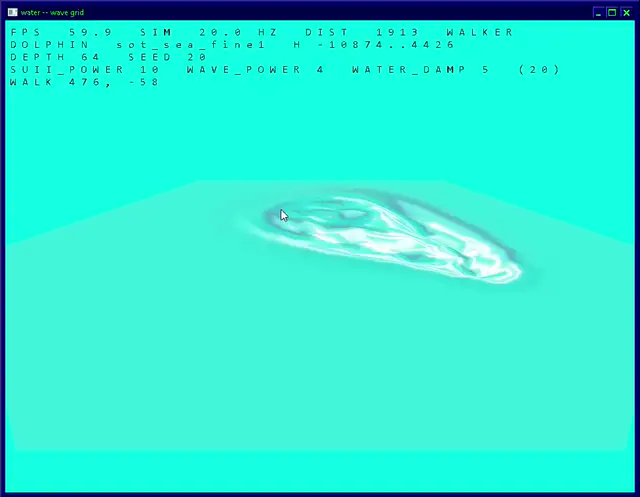

# Wave Race 64 Water Study

A standalone reimplementation of the water effect from **Wave Race 64**,
in C and Direct3D 9, built to understand how the effect works and to
test ways of running it at a modern frame rate.



## What this is

Wave Race 64's water is a 817-vertex hexagonal mesh over an integer
wave simulation, textured with a 32x32 sphere map. This program runs
that same simulation on that same mesh with the game's own textures,
but hands the vertices straight to D3D9 instead of building an N64
display list.

It reproduces one screen: the race results screen, which shows the
water head on with the patch fixed at the origin and no camera motion.
No boat, no course, no HUD. Just the water, where it can be looked at.

The algorithm is ported from the recovered N64 source. `wave_sea` and
`push_sea` are **literal transcriptions**, variable names and all, down
to which temporaries are 16 bits - the truncation is load bearing and
tidying it into something readable would be guessing at behaviour. The
mesh layout and the display list decode are reimplementations of what
those functions do.

## Why

Two reasons, and the second is the interesting one.

**To understand the effect.** Most of what makes Wave Race's water look
the way it does is not obvious from the code, and several things that
look obviously true are not. Section 9 of `plan.txt` records what was
actually found.

**To find out what higher frame rate costs.** The original simulates
and displays at 20 Hz during a race and 30 Hz on the menus, locked
together - `Graph_timing` gates the graph thread to every second or
third retrace, and physics and rendering are consecutive statements in
one function. Getting that to 60 Hz is not a matter of calling it more
often, and this program is where the alternatives get measured rather
than argued about.

## What the water actually does

Four things, none of which were obvious going in:

**The texture coordinates are a sphere map.** The sea pass sets
`G_ZBUFFER | G_SHADE` with no `G_TEXTURE_GEN` and no `G_LIGHTING`, so
the RSP generates nothing; `vertex_sea` computes a coordinate per vertex
from the surface normal. Working through the fixed point it reduces to
`u = 0.5 + 0.484*nx`, `v = 0.5 + 0.484*ny` over a single clamped,
non-tiled 32x32 image. Flat water samples the middle texel; a tilting
wave face sweeps the sample across the whole picture. That is the
"chrome" trick from the SGI demos.

**The water is translucent, not opaque.** The render mode is
`G_RM_AA_ZB_XLU_SURF` - depth compare on, depth write off, alpha
blended over the framebuffer. Alpha comes per texel from the texture and
runs as low as 71 of 255, so a good part of what the eye reads as water
is the background seen through it.

**The colour behind it is one flat rectangle.** There is no environment
light anywhere in the sea pass; the combiner is `TEXEL0` alone.
`makeKnSeaBottomGlist` fills the entire display rect with the course's
sea-bed colour and the water is blended over that. Course 1's bright
cyan is `(0, 242, 228)`, straight from `mSeaBottomColorTable`.

**One invisible point makes the waves.** On every menu screen a single
point walks the patch pushing a *negative* depth - a dimple, not a
crest - stepping 51.2 units per tick, turning by a small random rate,
and respawning on the rim when it leaves. It is the only thing
disturbing the water there.

## The frame rate problem

A tick is a fixed amount of *propagation*, not a fixed amount of
*time*. The relaxation's shifts encode wave speed and damping per tick,
so tripling the rate triples the speed. Press `C` and watch it happen.

Two approaches are implemented and can be compared directly:

**Render interpolation.** The simulation keeps the last two ticks and
the renderer blends between them, so 20 Hz water is smooth at 60 fps.
`L` locks rendering back to the tick rate for an A/B against the real
thing. This is exact at tick boundaries by construction, and it is what
the demo does by default.

**Retuning the shifts.** Since frequency goes as `2^(-WAVE_POWER/2)`,
a slower per-tick step can be traded against a faster rate. It works
for one step and then drifts: with `flags` rescaled at the switch a
single tick converts to about 5%, but by ten reference ticks the error
is 27 to 82% and by thirty it exceeds the signal. Leapfrog dispersion is
wavelength dependent, so one coefficient cannot hold every mode at once.
`Q`, `W` and `E` change the three shifts live if you want to see it.

Worth knowing: for a rate ratio `r` the shift wants `2*log2(r)`, so
powers of two land on integers. 30 Hz to 60 Hz converts exactly;
20 Hz to 60 Hz does not.

## Controls

```
Z          make a wave
X + mouse  drag to draw waves
Space      reset the water, flat and still
M          seed the chop        M+wheel  its amplitude
D + wheel  lift depth, 1 to 120   shift   step by ten

T / Y      next / previous course
Q / W / E  SUII_POWER / WAVE_POWER / WATER_DAMP
C          sim rate 20 / 30 / 60 Hz
L          lock rendering to the sim rate
F5         the menu-screen walker
N          point / linear texture filter
B          blend mode: n64 / zwrite / opaque / both
TAB        wireframe
P          pause          .  step one tick
R          home view      F  maximize
F1         help           Esc  quit

left drag  orbit     right drag  pan     wheel  zoom
```

## Building

Visual Studio 2017, toolset v141, SDK 10.0.17134.0, `Win32` only.
Open `water.sln`, or:

```
msbuild water.vcxproj -p:Configuration=Release -p:Platform=Win32
```

No external dependencies. `d3d9.dll` is loaded by name at run time, so
no import library is needed, and there is no D3DX - the two matrices
are built by hand. Both configurations build with zero warnings.

## Layout

```
src/main.cpp      console, window, frame loop, camera, overlay
src/d3d9rt.cpp    device, texture upload, draw, GDI text atlas
src/sea.c         the mesh, wave_sea, push_sea, the walker
src/textures.c    the eight sea textures, generated
src/timing.c      QueryPerformanceCounter wrapper
plan.txt          the design and everything found along the way
```

